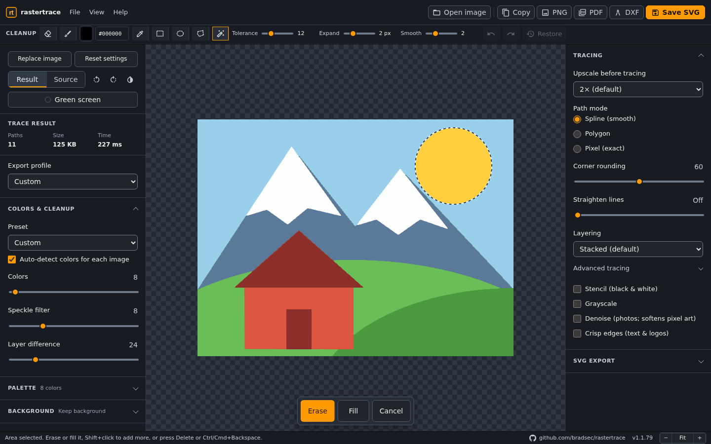

# rastertrace

[](https://github.com/bradsec/rastertrace/actions/workflows/tests.yml)
[](package.json)
[](LICENSE)
[](https://rastertrace.com)

Convert raster images to clean, scalable SVG vectors entirely in your browser. [vtracer](https://github.com/visioncortex/vtracer) compiled to WebAssembly plus a Canvas/JS preprocessing stage. Images never leave your machine: no upload, no backend.

**Live app: https://rastertrace.com/**



## Features

- Try a sample image (empty state, or File > Open sample image) loads one of 12 built-in samples at random, never the one shown last; three feature the rastertrace wordmark for testing text tracing.
- PNG, JPEG, WebP, GIF, and BMP input, up to 50 MB and 100 megapixels
- Premultiplied-alpha upscaling (no edge halos), binary alpha (no fringe fragmentation)
- Median-cut + k-means color quantization in perceptual Oklab space with transparent-area backfill; clusters below 0.1% of opaque pixels are reseeded toward the largest population-weighted color error so edge blends do not waste palette slots. Flat art whose most common colors cover 90% of pixels keeps exactly those colors, so small accents are not lost to anti-alias blends
- Speck removal on the reduced colors by area alone, in place of the tracer's filter (which also drops every line about 2 px wide or thinner): specks merge into the color around them, blend slivers along edges merge too, and thin lines and outlines between fills stay
- 3x3 majority filter to clean quantization dither (skipped when no colors were reduced, so lone pixels in pixel art survive)
- Optional edge-preserving median denoise for photographic sources
- Background removal: auto-detect from border sampling, hex color, or eyedropper pick from the image (sampled from the current preprocessed state, so the picked color matches the reduced palette); picked colors can be limited to areas connected to the edges, and edge removal can also clear enclosed background (letter counters, gaps between shapes) between adjustable minimum and maximum sizes and follow gradient backgrounds; with color reduction, edge-connected masks are built before quantizing so light subject edges do not leak; perceptual match tolerance; clean specks drops stray dots and fills pinholes; edge smooth rounds off jagged cutout edges and small bumps; edge trim chokes the cutout and defringe repaints leftover fringe without shrinking thin details
- Purpose-based profiles in a foldable Profile section: Web optimized, Balanced, High detail, Max detail, Pixel exact (every pixel kept, no upscale), Icon & logo, Print (spot colors, stacked), Vinyl & cutting (Cutout layers, each color separate pieces), Mono stencil (black, or white shapes only for white ink), Line art (scans: denoise and a lighter threshold), and Laser stencil set colors, cleanup, path detail, and output options together (all controls stay editable)
- Stencil mode: true black/white binary tracing for laser cutting, stamps, and silhouettes, with an adjustable brightness threshold and a choice of black-on-transparent or white-on-black ink
- SVG size export: preserve source pixels or write a custom width/height in px, mm, cm, or in, with the viewBox preserved
- Minified output option (also compresses path data with relative commands for roughly 30% smaller SVG files), or accessible output with `role="img"` and a `<title>` from the file name
- Simplify slider: one control for how closely paths follow the image, like Illustrator's Paths slider; sets the Advanced curve settings and shows Custom after they are edited by hand
- Straighten lines slider: snaps slightly wobbly or bumpy traced edges to true straight lines while keeping corners and real curves
- Advanced tracing controls: path coordinate precision, curve segment length, spline splitting
- Color-count presets from 2 to 256: a quick way to set Max colors that leaves every other setting as it is. Below 256, the traced SVG uses at most that many colors: each shape's fill snaps to the reduced palette, and defringe repaints only with colors already in it
- Color auto-detection (on by default): each opened image sets Max colors, Smallest shape, and Merge similar shades. Flat art gets one color per solid color in the image, small accents included (anti-alias edge blends do not count; JPEG, resized, or lightly noisy art is grouped by perceptual color so compression shades do not count either, and the detected colors seed the color reduction), and a Merge value below the gap between its two closest colors; photos get the defaults. Moving Merge similar shades keeps auto-detection on and recounts Max colors to the colors that stay separate; changing Max colors, a color preset, or a profile turns it off, except Balanced, High detail and Max detail, which keep it on: flat art then takes its own colors (up to the profile's count), photos the profile's values, and the profile stays selected for the next image. Reset to defaults detects the current image again.
- Crisp edges toggle: sharper corner tracing for hard-edged sources, available manually for any image.
- Path modes: smooth splines, straight polygons, or pixel-exact outlines with nearest-neighbor upscaling for pixel art
- Corner rounding slider: fine control over how sharply angles trace, from hard corners to flowing curves. Controls the current trace ignores are disabled: the curve settings outside Spline mode, and Max colors, Merge similar shades and Grayscale in stencil mode
- Layering modes: stacked shapes (smallest files) or vtracer 1.0's true seam-free mosaic with shared boundaries for laser cutting, vinyl, and CNC
- EXIF orientation respected: rotated phone photos load upright without distortion
- Invert (negative) toggle: trace the opposite regions, useful for stencils; composes with rotation and applies to the whole pipeline
- Paste an image from the clipboard (Ctrl/Cmd+V) to load it, alongside drag-and-drop and the file picker
- Same-fill paths grouped under shared `<g fill>` elements for smaller SVG files, each named `id="color-rrggbb"` so Illustrator and other editors show a named group per color in the Layers panel. Mosaic layering collects each color into one group; Stacked layering keeps drawing order, so a color drawn in several runs gets numbered names (`color-ffffff-2`)
- Upscale "Auto (fit 2048)" traces small images at the full 2048 px budget for maximum curve quality
- Live re-trace on setting changes, Save As dialogs for SVG, PNG, PDF, and DXF, clipboard copy, and PNG export at the trace resolution. Exports default to `<source>_rt.<ext>` so saving never overwrites the original image
- Vector PDF export (true curves, physical page size when set) for print shops and design handoff
- DXF export (R12) for CAD, CNC, and cutters: one closed polyline per shape, one layer per color, mm units when a physical size is set
- Saved profiles: Save profile stores every trace and export setting under your own name (palette edits and cleanup stay with the image). They appear under My profiles in the Profile list, and File > Manage profiles deletes them or exports and imports them as a `.json` file for another device or a teammate. Up to 50 profiles, kept in this browser
- Trace to my colors: Color source > My colors snaps every shape to a fixed palette, such as brand colors or stocked inks. Paste hex codes or import an Adobe `.ase` (Illustrator Swatches panel), GIMP/Inkscape `.gpl`, or text list of hex codes. Each pixel goes to its nearest swatch in Oklab, the SVG uses only those colors, and saved profiles carry the swatch list. RGB swatches are exact; CMYK, Lab and spot colors from `.ase` files are converted to screen RGB without a color profile, so they are approximate. Up to 256 swatches
- Settings persist across visits and image replacements: with color auto-detection off, every setting carries over unchanged; one-click Reset in the Trace settings panel. When a visit starts with non-default settings, a notice over the preview offers Reset to defaults or Keep, including on phones
- Works offline after the first visit (service worker, everything stays local)
- Zoomable preview: pinch, scroll wheel, buttons, Fit (Ctrl/Cmd+0), or Actual size (Ctrl/Cmd+1); drag or use the arrow keys (Shift for larger steps) to pan. Hold Space and drag to pan with any cleanup tool active, like Illustrator's Hand tool. A second finger during an eraser, brush, or selection gesture switches to pinch-zoom and undoes the partial stroke
- Vector eraser that works across the full preview, including strokes started outside an image edge, with a zoom-aware circular cursor (also shown over the preview while the size changes, so touch users see the diameter before drawing), adjustable diameter, `[` and `]` size shortcuts, undo/redo, and Restore Original. Cleanup masks are included in SVG and PNG exports. Opening another image asks first when there is cleanup or palette work to lose, and a file that fails to open leaves the current trace untouched.
- Palette editing: change any traced color by HEX or RGB without retracing. Hide color makes a color transparent, exact in Cutout layering. The button changes to Show color to restore it. In Stacked layering, hiding a color reveals the shape beneath it; hiding the background color makes it transparent. The palette panel offers a one-click Use cutout layering option. Pick a color from the result at any palette size, or choose from the swatch grid when the trace has 32 colors or fewer. Edits apply to the preview and to SVG, PNG, PDF and DXF exports, survive retraces that keep the color, and reset when a new image loads. Each edit follows a reduced-palette color, so every traced region of that color changes together; with Colors set to All (no reduction) and in stencil mode, edits match exact traced fills Hidden colors have eye-off badges and a separate count in the Palette panel. Merge similar colors by Shift- or Ctrl-clicking swatches (or Select on touch screens) and pressing Merge: they take the color of the largest one and become one swatch with a count badge, exported as one color group; colors edited to the same value merge the same way, and Split colors restores them.
- Vector blob-fill brush with adjustable diameter, color picker, editable hex color, active traced-palette eyedropper, and shared cleanup undo/redo. Fill strokes are included in SVG and PNG exports.
- Photoshop-style rectangular and elliptical marquees, a point-to-point polygonal lasso, and a magic wand (`W`) that selects only the connected area of the clicked color (Shift+click adds areas, Tolerance takes similar shades, Expand covers leftover edges, Smooth rounds off jagged pixel steps). Hold Shift when starting a selection to add to it or Alt/Option to subtract (the cursor shows + or −, and New/Add/Subtract buttons do the same on touch); selection tools can be mixed. Use `M`, `Shift+M`, or `L`; during a marquee drag, Shift constrains proportions and Alt/Option draws from center, then use the Erase, Fill, or Cancel buttons below the preview, or press Delete/Backspace to remove the selected area or Ctrl/Cmd+Backspace to fill it with the blob-brush color. While drawing a lasso, Backspace or Esc removes the last point; a Close shape button finishes it without a keyboard.
- Rotate the loaded image in 90 degree steps
- Trace size capped at 2048 px on the longest side: by default (Auto) flat art is scaled to fill it, so small images upscale for smoother curves and closer fidelity, while photographic sources upscale at most 2x (their noise gains nothing from more); images already at the cap trace as they are, and large photos downscale proportionally. Pixel settings (Smallest shape, clean specks, edge smooth, edge trim, defringe, wand expand and smooth) scale with the trace, so a value covers the same part of the image at any upscale (the status line reports the applied scale). Opt-in Ultra mode raises the cap to 4096 px for the cleanest fabrication exports (slower, high memory)
- Guidance built in: photographic sources and high path counts get footer status suggestions, with separate tracing, vector cleanup, and SVG export guides available from Help
- Three-panel editor laid out like Lightroom or Illustrator: profiles, color count and the palette on the left, settings on the right in work order (1 Background, 2 Cleanup, 3 Tracing, 4 SVG export, folded panels showing their current value), and view controls (Result/Source/Compare, backdrop, rotate, invert) on a strip above the preview. Compare shows the source left and the SVG right of a divider you drag, or move with the arrow keys; it keeps the zoom and pan, and the divider position is remembered. A label on the preview names the source whenever it shows, and editing a palette color while viewing Source switches back to Result; a setting change switches once the new trace is ready. Cleanup tools sit in a Photoshop-style rail on the preview's left edge, and the active tool's options take over the strip; on phones the rail floats over the preview, folded to the chosen tool with a tray for the rest, and options open in a bottom panel. Rotate and invert are also in the View menu. Either side folds to a narrow rail, Ctrl+\ hides or shows both, and the layout is remembered; narrow desktops start with the profiles folded. Trace stats sit in the status bar. Independently scrolling controls, responsive mobile stacking, keyboard operation, and WCAG AA contrast. On touch devices controls are at least 44px tall and fields use 16px text so iOS does not zoom. On small screens one finger scrolls past the fitted preview, the status line and zoom controls stay pinned to the bottom, and brush size, color, and Restore appear while a cleanup tool needs them

## Structure

```
index.html          app shell
sw.js               service worker: offline cache for the static app
css/styles.css      design tokens + layout
assets/icons/       locally bundled Material SVG icons
assets/samples/     built-in sample images (PNG) and their SVG sources
js/preprocess.js    pure pixel/string ops (Node-testable, no browser APIs)
js/vectorexport.js  DXF and PDF writers from traced SVG (Node-testable)
js/eraser.js        eraser mask geometry (Node-testable)
js/magicwand.js     magic wand region fill and outline (Node-testable)
js/pipeline.js      decode, premultiplied rasterize, worker round-trip
js/worker.js        Web Worker: preprocessing + wasm trace off the main thread
js/app.js           app core: trace loop, image loading, menus, startup
js/context.js       shared DOM references and mutable state
js/settings.js      preferences, profiles, presets, persistence
js/exporters.js     export post-processing and SVG/PNG/PDF/DXF save
js/cleanup-tools.js eyedropper, selections, vector eraser and blob fill
js/palette.js       palette extraction and fill recoloring
js/palette-ui.js    palette panel, color editor and result eyedropper
js/view.js          zoom and pan
pkg/                wasm-pack output (committed so Pages serves it as-is)
wasm/               Rust wrapper crate around vtracer
tests/              node --test unit tests
e2e/                Playwright layout and workflow tests
```

## Develop

```bash
npm ci                   # install the locked development dependencies
npm test                 # unit tests (node --test)
npm run test:responsive  # Playwright suite in desktop Chromium and iPad WebKit, plus an upgrade test from the previous release
npm run typecheck        # check JavaScript and DOM types
npm run lint             # run Oxlint
npm run format:check     # verify Oxfmt formatting
npm run format           # apply Oxfmt formatting
npm run check:icons      # verify bundled Material icons match the pinned package
npm run check:cache-busters # verify every ?v= URL changed with its file
npm run fix:cache-busters   # bump stale ?v= URLs (cascading to importers) and record them
npm run serve            # http://localhost:8137
npm run build:wasm       # rebuild pkg/ (Rust 1.94.0 and wasm-pack 0.15.0)
```

Asset URLs carry `?v=` cache busters, and `sw.js` serves them cache-first. Any edit to a file, including a changed import line, needs a new `?v=` in every URL that names it, which in turn edits those files. `npm run fix:cache-busters` does the cascade and records versions and content hashes in `scripts/cache-busters.json`; CI fails when a file changed under its recorded version.

## Deploy

`pkg/` is committed, and CI rebuilds it to confirm the checked-in binary matches the source. The build script sets `--remap-path-prefix` so dependency panic locations do not embed `$CARGO_HOME`, which otherwise made the output differ between machines. Rebuilding `pkg/` means bumping the `?v=` on both wasm URLs in `js/worker.js`.

Static files only. The GitHub Actions workflow validates pushes to `main` and pull requests. Production hosting for [rastertrace.com](https://rastertrace.com/) is managed separately from this repository.

## Browser support

Requires OffscreenCanvas and module workers: Chrome/Edge 109+, Firefox 111+, Safari 16.4+. Chrome and Edge offer native Save As dialogs; other supported browsers use their standard download flow because they do not expose a file-location picker to web pages.

## Acknowledgements and credits

[vtracer](https://github.com/visioncortex/vtracer) by Vision Cortex powers rastertrace's raster-to-SVG tracing. The Rust tracing engine is compiled to WebAssembly and runs locally in the browser.

Shipped runtime libraries and assets:

| Component                                                                            | Purpose                                                                | Licence (SPDX)    |
| ------------------------------------------------------------------------------------ | ---------------------------------------------------------------------- | ----------------- |
| [vtracer](https://github.com/visioncortex/vtracer)                                   | Raster-to-vector tracing                                               | MIT OR Apache-2.0 |
| [visioncortex](https://github.com/visioncortex/visioncortex)                         | Image processing and geometry used by vtracer                          | MIT OR Apache-2.0 |
| [wasm-bindgen](https://github.com/wasm-bindgen/wasm-bindgen)                         | Rust/WebAssembly bindings for JavaScript                               | MIT OR Apache-2.0 |
| [Material Design Icons](https://github.com/google/material-design-icons), Google LLC | Bundled SVG interface icons, sourced from `@material-design-icons/svg` | Apache-2.0        |

vtracer and visioncortex are dual-licensed; rastertrace uses them under the MIT option. Fonts use system fallbacks; no font files are bundled or downloaded.

Development-only tools, not shipped with the app:

- [Playwright (`@playwright/test`)](https://github.com/microsoft/playwright): browser tests, Apache-2.0.
- [Oxlint](https://github.com/oxc-project/oxc): linting, MIT.
- [Oxfmt](https://github.com/oxc-project/oxc): formatting, MIT.
- [TypeScript](https://github.com/microsoft/TypeScript): type checking, Apache-2.0.

## License

rastertrace is licensed under [MIT](LICENSE). See [THIRD-PARTY-LICENSES.txt](THIRD-PARTY-LICENSES.txt) for the full licence texts of every third-party component in the app, including the Rust crates compiled into the WebAssembly module.
